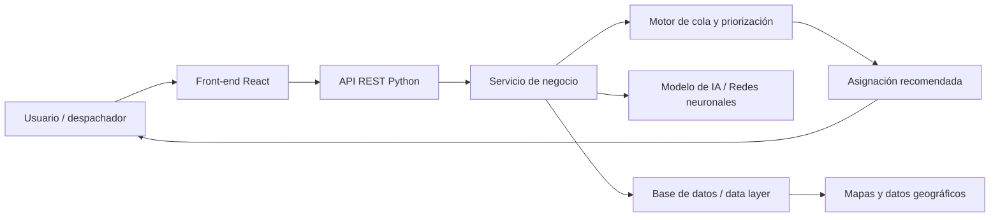
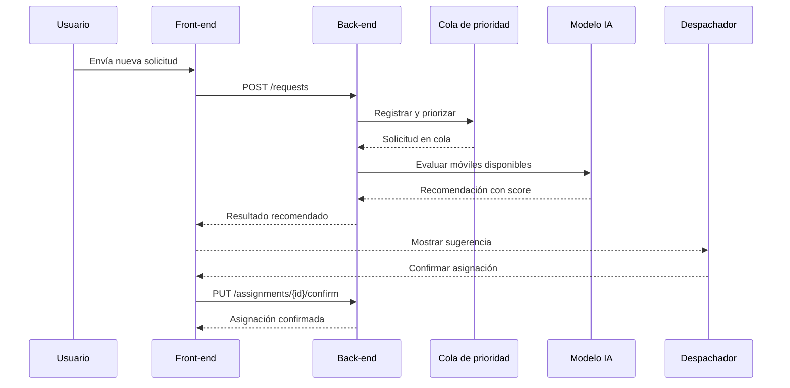

# Software Design Document (SDD)

## 1. Información del proyecto

- Nombre: Vital Express
- Tipo: Sistema de control y monitoreo operativo para móviles y solicitudes de usuarios
- Contexto: despliegue en la nube
- Fecha: 2026-11-14

## 2. Resumen ejecutivo

Vital Express es una plataforma de despacho y monitoreo para servicios médicos en tiempo real. El sistema integra una vista geográfica interactiva con información operativa sobre móviles, solicitudes de atención, tiempos de respuesta, costos y estado de la operación. La solución está compuesta por dos capas principales:

- Front-end en React para la visualización, interacciones y gestión operativa del despachador
- Back-end en Python para lógica de negocio, APIs, orquestación de eventos y modelos de IA

El sistema prioriza solicitudes con una cola basada en urgencia, usando un esquema FIFO reordenado por pesos de prioridad. Además, recomienda la móvil a asignar según variables como categoría, ubicación, carga de trabajo y tiempo de ruta. El despachador valida la asignación final antes de confirmar el servicio.

## 3. Objetivos

### 3.1 Objetivo general

Diseñar y desarrollar un sistema de gestión y despacho que permita coordinar de forma eficiente la atención médica urgente, reduciendo tiempos de respuesta y mejorando la toma de decisiones operativas.

### 3.2 Objetivos específicos

- Visualizar en tiempo real la ubicación y estado de las móviles
- Monitorizar solicitudes de usuarios y su prioridad asistida por reglas y IA
- Recomendar la mejor móvil disponible para cada servicio
- Reducir la latencia entre solicitud, análisis, asignación y despacho
- Proveer indicadores de respuesta, costo y desempeño operativo
- Facilitar la trazabilidad y auditoría de decisiones

## 4. Alcance

### 4.1 Incluye

- Mapa interactivo con posición geográfica de móviles y solicitudes
- Tablas dinámicas de programación, asignación y cronograma de servicios
- Cola de atención con priorización por urgencia
- Motor de recomendación de asignación para despachadores
- Panel de métricas: tiempo de respuesta, costo, disponibilidad y productividad
- API REST para integración con servicios de mapas, datos operativos y modelos de IA

### 4.2 Excluye por ahora

- Autonomía total de despacho sin intervención humana
- Integración con dispositivos móviles de pacientes o conductores más allá del alcance inicial
- Facturación electrónica o módulos contables avanzados
- Integración con sistemas de terceros no definidos todavía

## 5. Características principales del negocio

- El sistema recibe solicitudes de servicios médicos con prioridad definida por triaje
- La cola se comporta como FIFO reordenado en función del peso de urgencia
- Cada móvil tiene atributos como ubicación, disponibilidad, categoría, estado operativo y carga de trabajo
- El modelo de IA recomienda la mejor móvil según la categoría de atención, distancia, carga y tiempo estimado de ruta
- El despachador aprueba o corrige la recomendación antes de confirmar la asignación

## 6. Actores del sistema

### 6.1 Despachador operativo

Persona responsable de revisar solicitudes, validar recomendaciones y confirmar asignaciones.

### 6.2 Supervisor o administrador

Monitorea el estado general del sistema, métricas, desempeño y servicio en curso.

### 6.3 Móviles / conductores

Entidades operativas con disponibilidad y ubicación variables que reciben y ejecutan servicios.

### 6.4 Sistema de IA

Módulo analítico encargado de recomendar la asignación óptima de recursos.

## 7. Visión arquitectónica

La arquitectura será modular y separada por responsabilidades. La capa de presentación estará en React y la lógica de negocio y análisis inteligente en Python.

### 7.1 Diagrama de alto nivel



### 7.2 Principios de diseño

- Separación clara entre UI, lógica de negocio y analítica
- APIs bien definidas y versionadas
- Procesamiento de eventos y datos en tiempo real
- Escalabilidad horizontal en entornos cloud
- Seguridad por defecto para autenticación y uso de APIs

## 8. Requisitos funcionales

### RF-01: Visualización del mapa

El sistema debe mostrar una vista geográfica con la ubicación de las móviles y de las solicitudes activas.

### RF-02: Estado operacional

Cada móvil debe evidenciar su estado: disponible, en servicio, en tránsito, sin disponibilidad o mantenimiento.

### RF-03: Solicitudes del usuario

El sistema debe registrar la información de cada solicitud, incluyendo tipo de servicio, ubicación, categoría, urgencia y hora de creación.

### RF-04: Cola de prioridad

El sistema debe organizar las solicitudes según una cola FIFO reordenada por prioridad según el triaje y el peso de urgencia.

### RF-05: Recomendación de asignación

El sistema debe sugerir la mejor móvil según categoría, ubicación, carga de trabajo y tiempo de ruta.

### RF-06: Confirmación por despachador

La asignación sugerida debe ser revisada por el despachador antes de ser confirmada.

### RF-07: Panel de indicadores

El sistema debe mostrar tiempo de respuesta, costo del servicio, disponibilidad y rendimiento general.

### RF-08: Tablas dinámicas

El sistema debe mostrar cronogramas y tablas de asignación con actualización dinámica conforme cambia el estado operativo.

## 9. Requisitos no funcionales

### RNF-01: Rendimiento

La vista debe actualizarse en tiempo real con latencia mínima, considerando el volumen operacional esperable.

### RNF-02: Escalabilidad

El sistema debe soportar crecimiento de usuarios, móviles y solicitudes sin degradar significativamente la experiencia.

### RNF-03: Disponibilidad

La plataforma debe estar desplegada en la nube con tolerancia a fallas y monitoreo de salud.

### RNF-04: Seguridad

Se deben proteger endpoints y datos sensibles mediante autenticación, autorización y manejo seguro de credenciales.

### RNF-05: Mantenibilidad

El sistema debe estar estructurado en módulos desacoplados para permitir evolución incremental.

## 10. Casos de uso principales

### 10.1 UC-01: Registrar nueva solicitud

1. El usuario crea una nueva solicitud
2. El sistema valida la información de ubicación y prioridad
3. La solicitud se ingresa a la cola de despacho
4. Se evalúa su urgencia y se asigna prioridad calculada

### 10.2 UC-02: Visualizar estado operativo

1. El despachador accede al panel principal
2. El sistema presenta el mapa, tabla de móviles y cola de trabajo
3. El usuario puede filtrar por categoría, ubicación o estado

### 10.3 UC-03: Recomendar móvil

1. El sistema identifica la solicitud más prioritaria
2. Evalúa móviles disponibles según variables relevantes
3. Genera una recomendación con score estimado
4. Muestra la decisión en una interfaz de despacho

### 10.4 UC-04: Confirmar asignación

1. El despachador revisa la recomendación
2. Confirma o ajusta la asignación
3. El sistema registra la decisión y actualiza la operación

## 11. Diseño funcional del front-end

### 11.1 Objetivo

Proveer una interfaz fluida y operativa para despachadores y supervisores, con enfoque en visualización y toma de decisiones.

### 11.2 Componentes previstos

- Mapa interactivo
- Panel de control general
- Cola de prioridad
- Tabla de móviles
- Tabla de cronograma y asignación
- Panel de indicadores de servicio
- Modal de confirmación de asignación

### 11.3 Stack sugerido

- React
- Vite
- TypeScript (opcional pero recomendado)
- Estado global con Zustand o Redux Toolkit
- Mapas con Leaflet, Mapbox o Google Maps
- Estilos con CSS Modules, Tailwind o CSS moderno

### 11.4 Estructura sugerida

```text
front-end/
  src/
    app/
    components/
    features/
    hooks/
    services/
    store/
    types/
    utils/
```

## 12. Diseño funcional del back-end

### 12.1 Objetivo

Centralizar la lógica de negocio, la gestión de datos y la inteligencia artificial para asignación y priorización.

### 12.2 Módulos previstos

- API Gateway
- Servicios de solicitudes
- Servicios de móviles
- Motor de priorización de cola
- Motor de recomendación basado en IA
- Capa de persistencia y métricas
- Servicios de geolocalización y cálculo de rutas

### 12.3 Stack sugerido

- Python
- FastAPI
- Pydantic
- SQLAlchemy / Alembic (si se usa SQL)
- Pandas / NumPy
- Scikit-learn / TensorFlow / PyTorch para modelos neuronales
- Redis o Kafka para eventos en tiempo real (según necesidad)

### 12.4 Estructura sugerida

```text
back-end/
  app/
    api/
    core/
    models/
    schemas/
    services/
    ai/
    db/
    utils/
```

## 13. Modelo de IA y redes neuronales

El modelo de IA tendrá como objetivo recomendar la mejor móvil para una solicitud. Las variables de entrada consideran:

- categoría de servicio (I, II, III)
- ubicación geográfica de la solicitud
- de la móvil
- carga de trabajo acumulada
- tiempo de ruta estimado
- disponibilidad actual
- prioridad del caso

### 13.1 Enfoque inicial

Se propone un enfoque de aprendizaje supervisado con redes neuronales para predecir el score de asignación de cada móvil disponible a una solicitud determinada.

### 13.2 Salida esperada

Para cada móvil, el modelo proporcionará un score o probabilidad de idoneidad. El sistema ordenará las opciones y recomendará la de mayor valor.

### 13.3 Variables clave de entrada

- distancia entre móvil y ubicación solicitada
- tiempo estimado de llegada
- urgencia de la solicitud
- capacidad o tipo de móvil
- ocupación actual
- costo estimado asociado

## 14. Flujo de asignación



## 15. Datos y persistencia

### 15.1 Entidades principales

- Usuario
- Solicitud
- Móvil
- Asignación
- Prioridad
- Triage
- Evento de seguimiento
- Tramo de ruta

### 15.2 Consideraciones

- Se recomienda usar una base de datos relacional para transacciones de operación y cierta analítica
- Se puede complementar con almacenamiento de series temporales o eventos para métricas en tiempo real
- La IA puede operar sobre datasets estructurados exportados o consumidos desde pipelines de datos

## 16. Seguridad y cumplimiento

- Autenticación para usuarios del sistema
- Autorización por roles (despachador, supervisor, administrador)
- Protección de endpoints sensibles con JWT o tokens equivalentes
- Registro de auditoría para cada asignación y decisión
- Validación de datos de entrada y sanitización de entradas externas

## 17. Despliegue en la nube

Se propone desplegar la solución en un entorno cloud con separación de responsabilidades:

- Front-end: hosting estático o servicio web para UI
- Back-end: API en contenedores o servicio backend managed
- Base de datos: servicio managed con replicación y copias de seguridad
- IA: pipeline de entrenamiento/servicio por lotes o APIs internas
- Monitorización: registro de logs, métricas y alertas

## 18. Riesgos y mitigaciones

### Riesgo: mala calidad de datos
Mitigación: validación de entrada, limpieza de datos, métricas de calidad.

### Riesgo: recomendación poco confiable del modelo
Mitigación: validación del modelo con métricas, revisión humana y ajuste gradual.

### Riesgo: latencia alta en mapa y cola
Mitigación: uso de eventos, caché y optimización de consultas.

### Riesgo: cambios operativos no contemplados
Mitigación: diseño modular y procesos versionados.

## 19. Roadmap inicial

### Fase 1: base operativa

- Estructura de front-end y back-end
- Modelado de entidades principales
- API base y mock data
- Mapa visual básico

### Fase 2: lógica de priorización

- Cola FIFO reordenada por urgencia
- Criterios de triaje y carga operativa
- Dashboard de métricas

### Fase 3: IA y recomendación

- Dataset de entrenamiento
- Modelo de clasificación o regresión
- Recomendación de móvil por score

### Fase 4: producción

- Monitoreo, seguridad, despliegue cloud y mejoras continuas

## 20. Cierre

El documento actual define la base del diseño del sistema Vital Express. Aunque el problema y la solución se irán ajustando en próximos prompts, esta estructura provee una base sólida para comenzar con front-end React y back-end en Python con enfoque en redes neuronales y priorización operativa.
