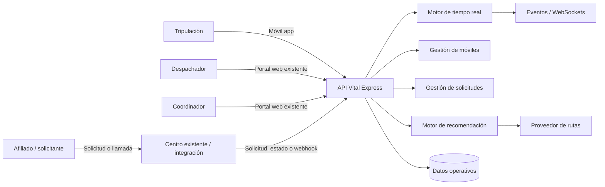

# Arquitectura: contexto y contenedores

ESTADO: Propuesto — pendiente de validación técnica con el portal existente

## Decisión de composición

Vital Express se diseña como una plataforma cloud con tres tipos de clientes:

1. **App móvil de las tripulaciones**, núcleo operativo del sistema.
2. **Portal web existente**, usado por despachadores y coordinadores.
3. **APIs y eventos del back-end**, integrados por ambos clientes.

Esta separación evita acoplar la lógica de asignación, prioridad y ubicación a la interfaz React existente.

## Actores

- Afiliado o solicitante
- Tripulación y móvil
- Paramédico regulador o despachador
- Coordinador de operación
- Plataforma de despacho existente
- Motor de recomendación
- Servicios de mapas y rutas

## Diagrama C4 — contexto

## Contenedores previstos

### 1. App móvil

- Tecnología propuesta: React Native, si se conserva React como tecnología principal.
- Recibe asignaciones y cambios de estado.
- Reporta ubicación y eventos operativos con protección de batería y conectividad.
- Permite aceptar, rechazar o informar estados como en tránsito y llegada.
- Debe soportar reconexión y procesamiento offline básico.

### 2. Portal React existente

- No se sustituye en este alcance inicial.
- Consume APIs REST y eventos para visualizar mapa, cola y asignaciones.
- No contiene lógica de prioridad ni recomendaciones; las recibe del back-end.
- Su integración exacta, autenticación y despliegue deben definirse con el equipo responsable.

### 3. Back-end Python

- FastAPI como API HTTP.
- Servicios modulares para solicitudes, móviles, asignaciones, ubicaciones y métricas.
- Motor de prioridad para la cola.
- Motor de recomendación compatible con modelos basados en redes neuronales.
- Ingesta de eventos y actualización de estado.

### 4. Persistencia

- Base SQL para entidades operativas y auditoría.
- Caché para ubicaciones recientes, disponibilidad y actualizaciones frecuentes.
- Almacenamiento de eventos o series temporales si se valida su necesidad.

### 5. Canal de tiempo real

- WebSockets o SSE para actualización de mapa y estado.
- FCM/APNs para avisos push en la app móvil.
- El protocolo definitivo depende de escala y proveedor cloud.

## Límites del sistema

En el prototipo no existe integración directa con producción, historial real de pacientes ni el sistema institucional. Toda integración se emula mediante datos sintéticos, mocks y contratos API versionados.

## Supuestos por validar

- Plataforma móvil objetivo: iOS, Android o ambas.
- Tecnología y código disponible del portal React existente.
- Mecanismo de autenticación compartido.
- Interoperabilidad con el sistema de despacho actual.
- Frecuencia aceptable de actualización de ubicación.
- SLA operativo entre asignación, aceptación y inicio del servicio.
