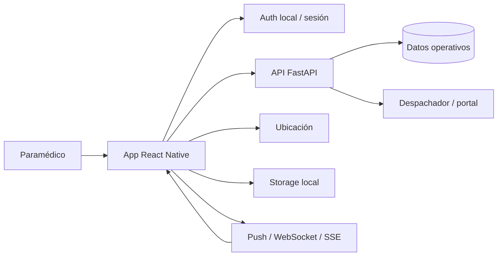

# Arquitectura móvil: app de paramédicos

ESTADO: Propuesto

## Responsabilidad

La app móvil representa a una unidad y tripulación. Debe informar estado operativo y sincronizarlo con el back-end, sin contener la lógica global de asignación o prioridad.

## Clientes

- app móvil paramédico;
- API FastAPI;
- canal push;
- canal tiempo real;
- almacenamiento local.

## Diagrama

## Estado y sincronización

El servidor conserva el estado oficial del servicio. La app mantiene una copia optimista y conciliada.

Para evitar diferencias:

- cada cambio tiene ID único;
- las transiciones se envían con idempotencia;
- el servidor valida el estado actual;
- conflictos se muestran al usuario;
- el historial completo se puede reconstruir desde eventos.

## Offline

La app puede conservar borradores y eventos, pero debe marcar si un estado está sólo confirmado localmente.

La sincronización posterior debe:

- ordenar eventos por timestamp lógico o secuencia;
- rechazar operaciones obsoletas;
- recuperar el estado oficial;
- informar al usuario si una operación fue rechazada.

## Seguridad

- tokens cortos y renovación segura;
- autenticación por unidad y usuario;
- permisos de ubicación explicados;
- datos locales cifrados;
- logout y revocación;
- no incluir datos sensibles innecesarios.

## Observabilidad

- eventos de conexión;
- latencia de sincronización;
- fallos de push;
- fallos de ubicación;
- transiciones rechazadas;
- pendientes offline;
- acciones críticas auditadas.
